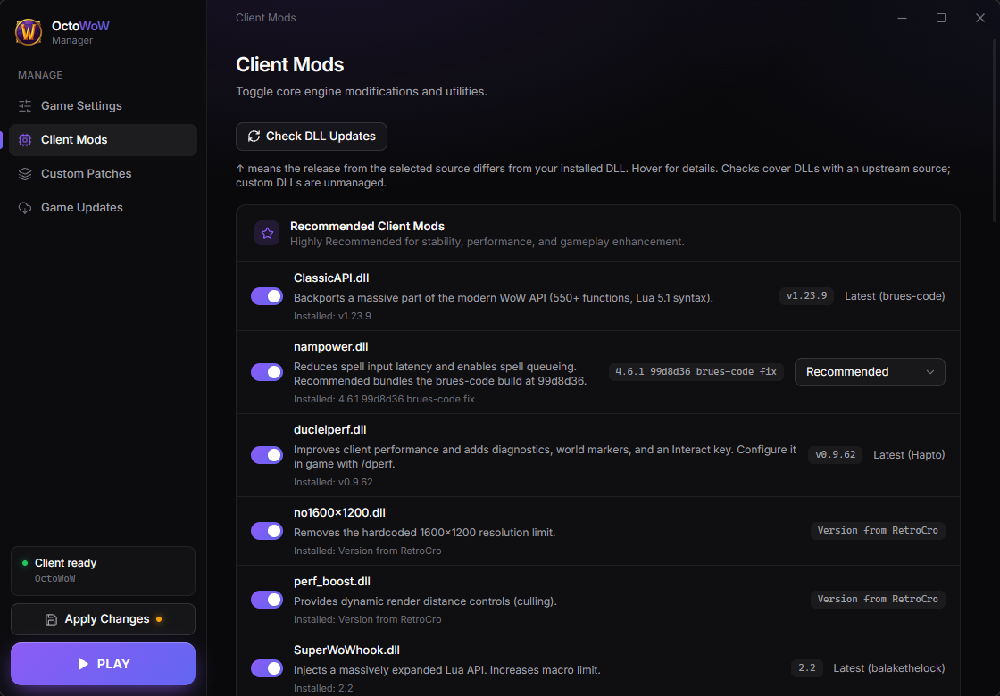
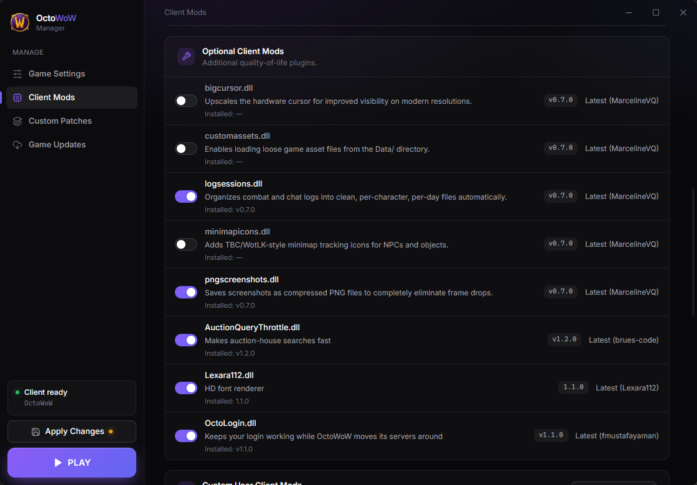
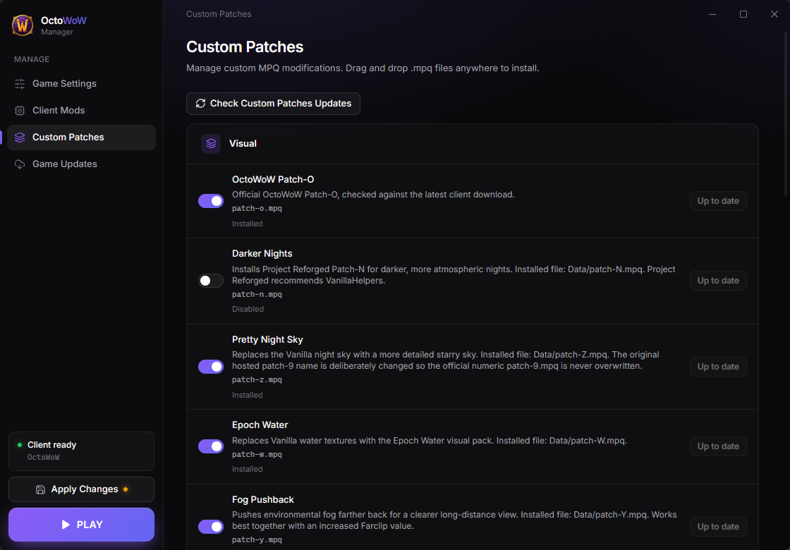
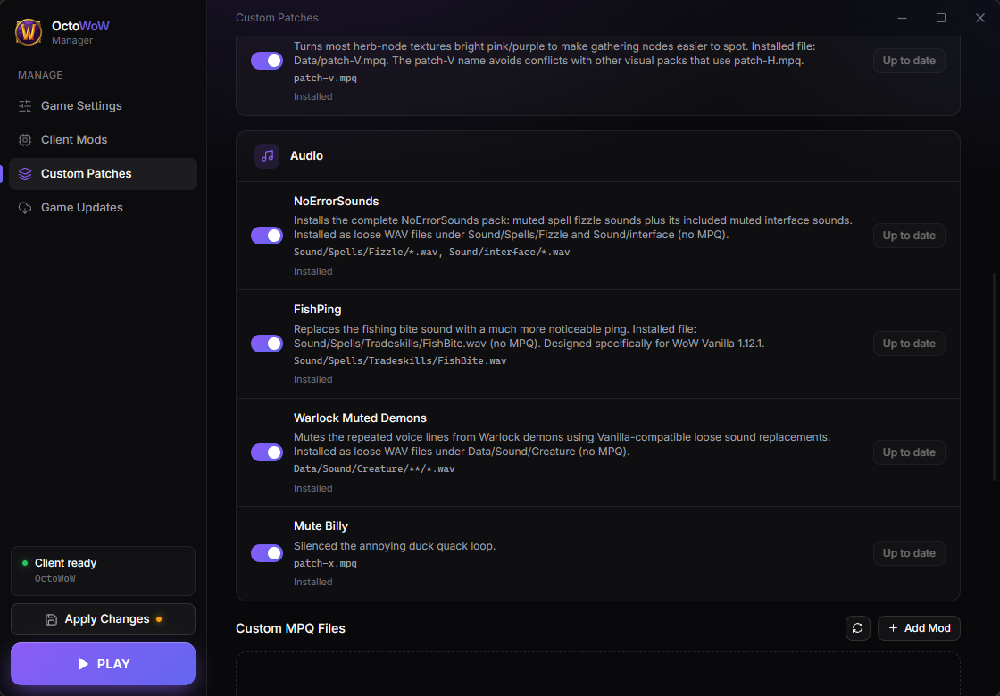
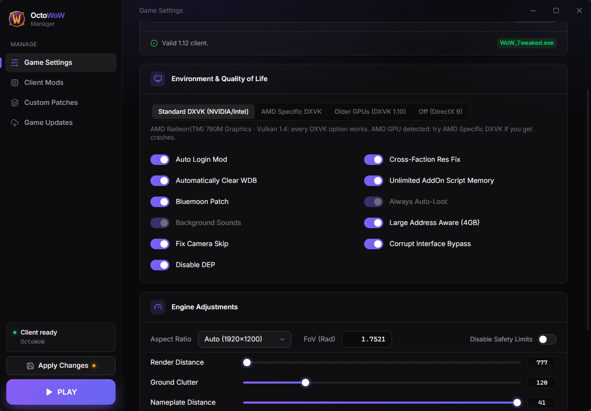

# OctoWoW Manager

Manage game settings, client DLLs, custom patches, and game updates for the OctoWoW client. This is a fork of [zmarotrix’s OctoWoW Manager](https://github.com/zmarotrix/OctoWoW-Manager), built with Rust, Tauri, and React for Windows. Linux and macOS versions are untested and will not be shipped by me.

## Download

See the [releases page](https://octowow.st/git/OEVG/OctoWoW-Manager/releases) for published downloads, or build from source using the instructions below. The Windows build is a standalone `.exe`.

Select your OctoWoW folder in **Game Settings**, click **Apply Changes**, then click **Play**. For a v2.6 setup, use **Game Settings → Import v2.6 settings** and select your old `octowow_config.json`.

## What’s new in 3.0.4

- **Addon management** now lives outside the manager. I use and recommend Dusk’s [GitAddonsManager](https://octowow.st/git/Dusk/GitAddonsManager/releases) to install and update your addons. Companion addons can still ship with client mods.
- **Game Settings** adds switches for Cross-Faction Res Fix, automatic WDB clearing, unlimited addon script memory, and the Bluemoon Patch. Auto-loot and background sound controls are disabled when SuperWoW is detected.
- **Client Mods** groups recommended, optional, and custom DLLs. Each managed mod shows its description, installed version, and source version where available. Use **Check DLL Updates** to compare your installed DLLs with their sources.
- **Recommended and optional DLLs** include DucielPerf in the recommended set, MarcelineVQ’s WeirdUtils v0.7.0, and optional AuctionQueryThrottle, Lexara112, and OctoLogin. The recommended nampower build (`4.6.1 99d8d36 brues-code fix`) ships with the manager. Other catalog DLLs download when you apply changes.
- **Custom Patches** groups the new visual and audio catalog by category, with file names, install status, and source credits. Visual patches include the official OctoWoW Patch-O and options for nights, skies, water, fog, and herbs. Audio patches include NoErrorSounds, FishPing, Warlock Muted Demons, and the bundled **Mute Billy** patch. You can still add your own `.mpq` files.

## Screenshots







## Features

- **Game Settings** includes aspect-ratio-aware field of view, engine and graphics settings, DXVK profiles, and client quality-of-life switches. Apply creates `WoW_Tweaked.exe` and preserves `WoW.exe`.
- **Client Mods** manages the DLL load list and supports adding your own DLLs.
- **Custom Patches** supports installing and toggling catalog patches, checking for updates, and managing your own MPQs. Drag an `.mpq` or `.dll` into the window to add it.
- **Game Updates** checks your client against the official OctoWoW release. It downloads the files that need repair or replacement, verifies them against release checksums, and supports resuming.

### Playing on Linux and macOS

Set **Game Settings → Installation → Wine command** if needed. The default is `wine`. The manager runs `VanillaFixes.exe WoW_Tweaked.exe` through the configured command. It accepts quoted paths, leading environment assignments such as `WINEPREFIX=~/Games/wow wine`, and Wine or Proton installation directories.

## Development

Install Node.js, Rust, and the [Tauri prerequisites](https://v2.tauri.app/start/prerequisites/) for your platform. On Windows, use `run-dev.bat` or run:

```sh
npm ci
npm run tauri dev
```

For a browser preview with sample data, run `npm run dev` and open `http://localhost:1420`.

Build the standalone Windows executable with:

```sh
npx tauri build --no-bundle
```

The executable is written to `src-tauri/target/release/octowow-manager.exe`. The repository also includes the upstream [build workflow](.github/workflows/build.yml) for Windows, Linux AppImage, and macOS builds.

Run the Rust tests with `cargo test --manifest-path src-tauri/Cargo.toml --lib`.

## Credits

Thanks to [zmarotrix](https://github.com/zmarotrix/OctoWoW-Manager) for the original manager, [Dusk](https://octowow.st/git/Dusk/Modernization-Tool) for Modernization Tool, and [Rook](https://octowow.st/git/Rook/RaidVisuals-OctoWoW) for the Mute Billy reference. The **Client Mods** and **Custom Patches** tabs link to the individual projects.

## License

[GPL-3.0](LICENSE). Bundled components retain their own licenses. See [Third-party notices](THIRD_PARTY_NOTICES.md).
