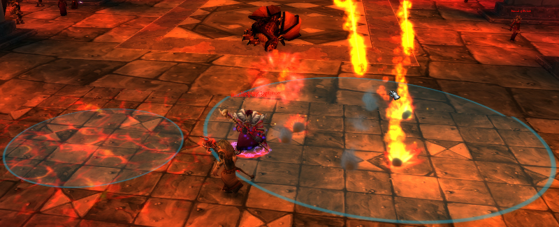

# RaidVisuals-OctoWoW
  
This is an OctoWoW-specific baseline fix for [MarcelineVQ/twow-raid-visuals](https://github.com/MarcelineVQ/twow-raid-visuals).

To use this project's visuals, download the latest release and unpack to your OctoWoW Data folder.

Patch - 1.14.20
- Removed Areatrigger.tbc to fix instances not working
(This had no use anyhow)

## Patches overview

The patches included in this repository adjust the visuals and sounds for several various spells and boss abilities.  They are applied in alphabetical order based on the patch file name so that later patches may override or build upon earlier ones.  
The patches currently are based on twow `1.18.0` dbc's, simply change out the .dbc files in the `dbc/` folder to use other versions.  
The highlights are summarised below:

- **AQ20:**
  - Captain Tuubid visibly marks the player targeted for Attack Command.  
  - Captain Drenn indicates the radius of Lightning Cloud.  
  - Anubisath Defenders indicate their Explosion range.  

- **Molten Core:**
  - Baron Geddon indicates the radius of his Inferno ability.  Living Bomb has a rough indication of area of effect.  
  - Incindus indicates the radius of his Fire Nova.  
  - Golem Twins indicate Molten Bulwark.  
  - Sorcerer-Thane Thaurissan
    - Indicates his rune debuffs on the player.  
    - Rescaled Rune of Power ground effect.  
    - Changed Rune of Power icon to be distinct from Rune of Detonation.  

- **Onyxia:** Burning Chains now has a proper fiery chains icon.

- **Blackwing Lair:** Warlocks and Spellbinders indicate the radius of their AoE damage.

- **AQ 40:**
  - Anubisath Sentinels have additional visual cues to help mageless compositions.  
    - Reflect bubbles and glowing shadow or fire in hand to show which reflect it is.  
    - A deep purple curse for Mana Burn.  
    - Rejuvenation effect for HoT.  
    - Lightning breath to indicate Thunder Clap.  
    - Red weapon to indicate Mortal Strike.  
    - Shadow breath to indicate Shadow Volley.  
  - Lord Kri and Viscidus poison area of effects indicate their radius.  
  - Anubisath Guardians indicate their Explosion range.  
  - Twin Emporer Blizzard and Bug Explosion indicate radius.  
  - Ouro Dirt Mounds indicate their radius.  

- **Naxxrams:**
  - Poison Charge now colors your character like other enemy poisons in the game do.  
  - Faerlina Acolytes are more obvious when casting Shadow Bolt Volley.  
  - Faerlina indicates the radius of her Rain of Fire.  
  - Thaddius polarity directly colors your character.  
  - Sapphiron Blizzards show their point of impact.  

- **Kara 40:**
  - Gnarlmoon Moon debuffs have reduced spell effects to improve fps.  
  - Incantagos Blizzard and Guided-Ley Beam have additional indication to show what area they affect.  
  - Anomalus soak zones have much improved visibility.  
  - Medivh Flamestrike indicates its area of effect. Corruption of Medivh has much stronger indication on your character.  
  - Rupturan Flamestrikes indicate their area of effect.  Dirt Mound indicates its radius.  
  - Sanv Tas'dal indicates the radius of his Overflowing hatred.  Netherwalkers, when visible in the first place, have improved visibility.  
  - Mark of the Highlord decurse explosion given rough area of effect indication.  
  - Trash:
    - Karazhan Protectors indicate Spell Reflect with green coloring.  
    - Crumbling Protectors indicate Self-Destruct Protocol with red coloring.  
    - Lingering Arcanists indicate their Blizzard area of effect.  
    - Arcane Anomaly indicates the application range of its stacking debuff.  

- **Timbermaw Hold:**
  - Karrsh's Seed of Corruption indicates its radius.  
  - Rotgrowl's Volley of Arrows indicates its radius.  
  - Loktanag's Infected Secretion indicates its radius.  
  - Xavian Image's Dream Fever indicates its spread range.  
  - Withermaw Defiler's Poison Cloud and Withered Defiling indicate their range
  - Peroth'arn's Flames of Purgation indicates its radius.  

- **Sound:**
  - Silenced the looping Baby Murloc dance sound.  
  - Silenced the annoying duck quack loop.  
  - Quieted Carvan Kodo footsteps.  
  - Quieted Repair Bot movement.  
  - Gave Concussion Blow a different sound than Shield Slam.  
  - Gave Totemic Recall a different sound than totem placement.  

- **Geometry:**
  - Adjusted pitfall on the ramp out of the magma in Blackrock Mountain.  
  - Molten Core: Added geometry for players to rest on when climbing back up after being unfairly knocked off Thaurissan's platform.  
  - Tower of Karazhan: Various changes, mainly better stair geometry to prevent players falling off. Restored entrance model as the TW one was a broken import.  
  - Sanv arena: Players of all sizes can now walk through the side fabric of the arena.  
  - Durotar to Kargath zeppelin: Removed a pitfalls when boarding.  

- **Other:**
  - Removed obnoxious green tinting from: Decaying Flesh debuff, Corrosive and Deadly Poison, Poison Spit pet attack, Gift of Arthas.  
  - Removed distracting stones from Earthquake.  
  - Removed transparancy from Reality Fracture.  
  - Small tooltip fix for Spirit of the Ancients.

## The problem

`patch-O.mpq` (raid-visuals) ships **full-replacement copies** of 9 client DBC files:
`AreaTrigger`, `CreatureModelData`, `CreatureSoundData`, `SoundEntries`, `Spell`,
`SpellIcon`, `SpellVisual`, `SpellVisualEffectName`, `SpellVisualKit`.

These were frozen from a Turtle WoW `1.18.0` snapshot. Because MPQ patches replace
whole files (not merge rows), any OctoWoW client running patch-O silently loses
**any DBC content OctoWoW added after that snapshot was taken** — since the
patched table simply doesn't have those newer rows.

**Concrete symptom:** summoning the "Buccaneer Bubbles" companion (item 98800,
a team-exclusive pet) crashed clients with an ACCESS_VIOLATION, and the
companion didn't even show up in the spellbook. Root cause: its model
(`CreatureModelData` IDs 2766/2767, `BabyOctopus`/`BabyOctopusPurple`) doesn't
exist in the frozen table raid-visuals ships. `Spell.dbc` alone was also
missing **71 spell records** OctoWoW has added since the snapshot.

## The fix

The `dbc/` folder in this repo holds **OctoWoW's current live DBC baseline**
for these 9 tables (extracted from OctoWoW's own client patch files), instead
of the frozen Turtle WoW snapshot.

`patches/` and `schema/` are **unchanged from upstream** — none of raid-visuals'
actual visual/sound logic was touched. Every boss AoE indicator, icon fix, and
sound tweak (duck mute, kodo footsteps, murloc dance, etc.) still applies
exactly as before; only the foundation they're layered on top of changed.

`built/` contains the already-patched output (baseline + all patches applied)
— these are the exact files currently shipped inside the fixed `patch-O.mpq`
release. If you have the original `wow_dbc_patcher` tool, running it with
`--dbc-dir dbc/` against this repo's `patches/`/`schema/` should reproduce
`built/` exactly.

## Two open questions for the dev team

1. **This baseline will go stale again** the next time OctoWoW adds content
   that lands in one of these 9 tables (new pets/mounts/spells especially).
   Worth deciding on a process to periodically re-sync `dbc/` against
   whatever OctoWoW's client currently ships.
2. Two of the "live" files I initially pulled (`CreatureSoundData.dbc`,
   `SpellVisualEffectName.dbc`) turned out to be **older/incomplete**
   compared to even the frozen Turtle WoW snapshot (missing records the
   frozen version had, e.g. the duck sound entry). I don't know which
   OctoWoW client file is the true current authoritative source for these
   two tables — if someone on the dev side can point to the right one,
   `dbc/` should be updated accordingly.
